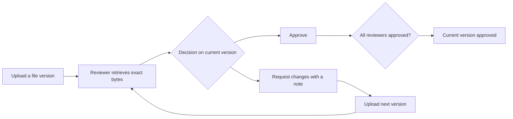

# Approval Folio · development component

**An open-source Filestage alternative in preparation for versioned PDF and image approvals.**

> Local API development preview. No browser workspace, hosted demo, or public release yet.



The implemented core stores immutable PDF/PNG/JPEG versions in SQLite. Each reviewer has a separate revocable key. Decisions refer to a version number and SHA-256 digest; a new version requires fresh decisions from everyone, even if the file content is identical. History remains available for export.

| Implemented | Still required |
| :--- | :--- |
| Independent reviewer credentials and owner authentication | Polished owner/reviewer browser UI |
| Immutable files, bounded PDF checks, attachment-only downloads | Six languages |
| Approve or request changes with a note | Polished owner/reviewer browser UI |
| Stale-version, wrong-hash and cross-project rejection | Six languages and browser acceptance |
| JSON history export and old-version retrieval | WSGI/container setup and recovery tests |

## Run the core checks

```sh
python3 -m venv .venv
. .venv/bin/activate
pip install -r requirements.txt
python -m unittest discover -s tests -v
```

Twenty-five tests cover reviewer consensus, new-version reset, stale uploads/decisions, byte-digest matching, per-reviewer retrieval, change-request notes, token revocation, project isolation, storage limits, persistence and file validation.

## Exact boundaries

- Owner methods (`create`, `upload`, `rotate`, `view`, `export`) rely on their caller for authentication. Use the authenticated boundary in `server.py`; do not expose these methods directly.
- Reviewer keys identify an assigned review slot, not a verified human identity. These decisions are not legal signatures.
- The core requires a recorded file retrieval before a reviewer can decide. Retrieval does not prove that the person read or understood the file.
- Up to 20 fixed reviewers per project; 10 MiB per file and 100 MiB per project including history. PDFs must be unencrypted and have 1–100 pages. Images are normalized to metadata-free PNG, at most 16 megapixels and 10 MiB after normalization.
- PDFs are parsed for structural acceptance but are **not sanitized or malware-scanned**. PDF structure checks run in a separate process with 256 MiB address-space and 3-second CPU limits, plus a 5-second parent timeout. These POSIX resource limits were tested on Linux; this is not a sandbox. HTTP downloads are attachment-only. No in-browser PDF rendering exists yet.
- No email delivery, reviewer groups, threaded annotations, version comparison UI, or full Filestage parity is claimed.

[Scope and distribution plan](docs/SCOPE.md) · [MIT license](LICENSE)

## Run the local development API

```sh
export APPROVAL_OWNER_KEY="$(python -c 'import secrets; print(secrets.token_urlsafe(32))')"
export APPROVAL_DATABASE=approval.sqlite3
python server.py
```

Listens on `127.0.0.1:8093`. Keep the generated owner key private. This development server is not a production deployment. [API routes and authentication](docs/API.md).
